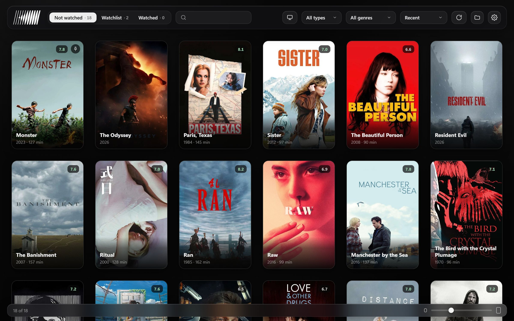

# Kino

[English](#english) · [Русский](#русский)

**[Website](https://idlorem.github.io/kino/) · [Сайт](https://idlorem.github.io/kino/ru.html)**

## English

A catalog for local movies and series on Windows, with an Android TV and phone client for streaming from your PC.

### Features

- Auto-fetches posters, descriptions and ratings (IMDb, Kinopoisk, TMDB, Letterboxd)
- Not watched, Watchlist and Watched tabs, search, sorting and filters
- Import a watchlist from a public Letterboxd profile
- Pin, hide, mark as watched, swap posters or fix wrong matches via right-click
- English and Russian interface with matching metadata (OMDb and IMDb for English, Kinopoisk for Russian)
- Access another PC's library over LAN or remotely via the built-in AmneziaWG VPN
- Android TV and phone app with audio and subtitle selection and playback resume

### Install

1. Download and run `installer.exe` from [Releases](../../releases/latest).
2. Pick your media folder and language on first launch.
3. Optional: add [OMDb](https://www.omdbapi.com/apikey.aspx) (English) or [Kinopoisk Unofficial](https://kinopoiskapiunofficial.tech) (Russian) API keys in settings for faster, more accurate matching. IMDb ratings work without keys.

### Android TV and phone

1. Enable the server in Settings → TV access (the PIN is optional).
2. Install `kino.apk` from [Releases](../../releases/latest), select your PC (or enter its IP) and type the PIN.

Allow Kino through Windows Firewall on private networks if prompted. Unsupported audio (like DTS) is converted or skipped automatically.

### Another PC and remote VPN

- **LAN:** turn on the server on the host PC, then click PC in the toolbar on the second machine (Auto connect is supported). Pins, hidden items and watched marks stay local and never alter the host library.
- **Over the internet:** load an AmneziaWG native `.conf` file in the remote library window, enable Connect through VPN, then enter your host's local IP (for example `192.168.0.10:8765`) and the PIN. No separate VPN app is needed.

### Letterboxd

Settings → Letterboxd → enter your username (the watchlist must be public).

## Русский

Каталог локальных фильмов и сериалов для Windows с клиентом для Android TV и телефона для просмотра с ПК.

### Возможности

- Автоподбор постеров, описаний и рейтингов (IMDb, Кинопоиск, TMDB, Letterboxd)
- Вкладки «Не просмотрено», «Хочу посмотреть» и «Просмотрено», поиск, сортировка и фильтры
- Импорт списка «Хочу посмотреть» из открытого профиля Letterboxd
- Закрепление, скрытие, отметки просмотра, смена постера и правка неверных совпадений по правому клику
- Русский и английский интерфейс с метаданными на выбранном языке (Кинопоиск для русского, OMDb и IMDb для английского)
- Доступ к библиотеке другого ПК по локальной сети или через встроенный AmneziaWG VPN
- Приложение для Android TV и телефона с выбором аудио и субтитров и продолжением просмотра

### Установка

1. Скачайте и запустите `installer.exe` из [Releases](../../releases/latest).
2. При первом запуске выберите папку с медиа и язык.
3. Необязательно: добавьте в настройках ключи API [Кинопоиск Unofficial](https://kinopoiskapiunofficial.tech) (русский) или [OMDb](https://www.omdbapi.com/apikey.aspx) (английский) для более точного поиска. Рейтинги IMDb работают без ключей.

### Android TV и телефон

1. Включите сервер в «Настройки» → «Доступ с телевизора» (PIN по желанию).
2. Установите `kino.apk` из [Releases](../../releases/latest), выберите ПК (или введите IP) и укажите PIN.

Разрешите Kino доступ в брандмауэре Windows для частной сети, если появится запрос. Неподдерживаемый звук (например, DTS) конвертируется или пропускается автоматически.

### Другой ПК и VPN

- **По локальной сети:** включите сервер на основном ПК, а на втором нажмите «Другой ПК» на панели (есть автоподключение). Закрепления, скрытые и просмотренные хранятся локально и не меняют библиотеку на основном ПК.
- **Через интернет:** загрузите `.conf` в формате AmneziaWG native в окне удалённой библиотеки, включите «Подключаться через VPN» и введите локальный IP домашнего ПК (например, `192.168.0.10:8765`) и PIN. Отдельное приложение VPN не нужно.

### Letterboxd

«Настройки» → Letterboxd → укажите ник (список должен быть публичным).
